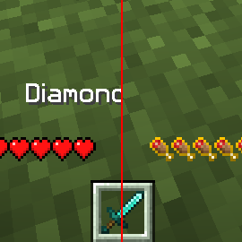

  

<h1 align="center">Toggle Tooltips</h1>

  Hide the item name that pops up above the hotbar when you hold or switch items.
    
  
  
  
  

## ✨ Features

- Show or hide the held-item name above the hotbar (**hidden by default**), all other tooltips stay untouched
- One on/off button in the settings screen via [Mod Menu](https://modrinth.com/mod/modmenu)
- Client command to open the settings or switch directly
- Saved automatically
- Client-side only, works on any server
- English, German, French and Spanish

## 📦 Requirements

Minecraft **26.2** · Fabric Loader **0.19.1+** · [Fabric API](https://modrinth.com/mod/fabric-api) · Java **25** · [Mod Menu](https://modrinth.com/mod/modmenu) *(optional)*

## 🚀 Usage

| Command | Effect |
| --- | --- |
| `/hotbaritemname` | Opens the settings screen |
| `/hotbaritemname on` | Shows the item name |
| `/hotbaritemname off` | Hides the item name |

## 🔧 How it works

The mod wraps Fabric API's vanilla HUD element for the held-item tooltip (`VanillaHudElements.HELD_ITEM_TOOLTIP`) and only lets it render when the option is enabled. No mixins.

## 📄 Source & License

This repository is for viewing the source code only, build instructions are intentionally not included. License: [LICENSE.txt](LICENSE.txt).
 